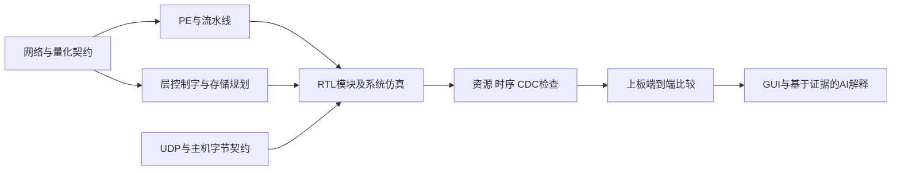

# 项目开发技能包：从 SNN 算法到 FPGA 系统实现

本目录对应赛题 **3.3.5.2 技能包**，覆盖本项目的算法映射、RTL 设计、存储与调度、以太网集成、验证与时序、上位机与 AI 辅助分析。各项把项目中的具体实现提炼为可重复执行的提示词工作流、设计模板、参考模型和验证方法，供其他队伍在新题目中使用。

技能根据已完成项目的源码、注释和现有报告整理。没有保存的历史提示词、试错次数、前后性能提升，不补写为事实。下文区分“已有实现依据”“本次新增模板验证”“下一项目必须完成的验证”。新增 RTL 是便于迁移的独立设计模板，不作为本项目原始 RTL 的等价替换。

## 一、技能导航与适用边界

| 技能 | 适用范围与使用方法 | 主要产物 | 失效条件 |
| --- | --- | --- | --- |
| [01 算法到硬件映射](algorithm-mapping/SKILL.md) | 将网络层、脉冲时间步、量化与布局转成硬件契约；附模型与导出代码，使用其中提示词和整数参考模型 | 层映射表、位宽预算、定点参考、布局约定 | 动态网络、非二值激活、不同神经元复位规则需另定模型，不能只改网络名 |
| [02 RTL 数据通路设计](rtl-design/SKILL.md) | 设计 PE、加法树、累加、发放/末层输出；先定义周期接口，再用参数化 RTL 与自检 TB 验证 | 流水线表、`spike_mac.sv`、自检 testbench、RTL 评审模板 | 模板不含池化/反卷积/旁路/背压/CDC，不能替换整个原始 PE；不证明时序收敛 |
| [03 存储与层间调度](memory-scheduling/SKILL.md) | 设计 BRAM/URAM/DDR 分工、双缓冲、控制字；用 schema 编解码 COE，对照 ILC 状态机 | 95位字段 schema、COE 编解码脚本、存储规划表 | 更换控制字版本或 IP 读延迟需同步修改；多时钟请求须使用相应握手，不能靠改位宽解决 |
| [04 UDP 与系统联调](udp-integration/SKILL.md) | 定义主机/FPGA 字节顺序、分包、权重装载与推理时序；用纯函数转换及负数边界用例 | 权重重排/输入打包/输出解码工具、联调流程与故障分层 | 当前协议没有帧号/可靠重传，不能将包长正确当作帧完整性证明 |
| [05 仿真与实现验证](verification-closure/SKILL.md) | 从模块到系统建立黄金参考、记分板、边界测试，审查资源、setup/hold 与 CDC | 事务轨迹记分板、测试矩阵、报告审查提示词、验证记录 | 功能仿真不等于上板；强制 ready=1 的 TB 不验证阻塞；WNS为正不等于全部时序闭合 |
| [06 上位机与 AI 集成](host-ai/SKILL.md) | 分离采集/解码/展示/分析，将异步回答绑定请求样本，用实算指标约束大模型 | 不可变帧上下文模板、分析提示词、交互验收方法 | 主机 UUID 不能补证板端身份；数值摘要不能支持热图形态或硬件根因结论 |

每个 `SKILL.md` 均给出适用范围、使用步骤、可复制提示词、项目案例、验证效果及失效条件。可直接把对应文件交给大模型，也可人工按流程执行。无需依赖特定 AI 账号。源码缩写 `rtl/...`、`tb/...` 相对 `snn_top_v3/eth_ddr_test/`；`pc_python/...`、`file/...` 相对仓库根目录。复制到其他项目时需替换材料路径。

## 二、贯穿项目的设计方法



使用顺序不是固定开发日程，而是依赖关系：算法的时间步、数据布局和定点规则先约定；RTL 的数据与控制按同一事务对齐；缓冲区所有权和 DDR 接受条件写清；再建立可定位的验证层级。软件浮点输出、量化整数输出、RTL 输出和目标温度场承担不同参考角色，不能互相替代。

本项目的可参考案例：200×200、T=3、32路 PE、16位权重与32位累加；按层控制 ROM 调度；BRAM/URAM 特征图与 DDR 权重存储；UDP 连接 Python GUI。以上是案例配置，不要求下一题照搬。源码中的网络模式、通道组计数、尺寸特判和 IP 延迟仍需逐项核对。

## 三、直接复用的模板与工具

| 文件 | 用途 | 使用方式 |
| --- | --- | --- |
| [层契约表](algorithm-mapping/assets/layer-contract.csv) | 为新网络填写逐层形状、量化、布局、存储与清零规则 | 复制后填写；示例行是格式演示，不代表原网络完整层表 |
| [整数参考模型](algorithm-mapping/scripts/numeric_reference.py) | 定点量化、补码、二值脉冲点积和单步神经元参考 | 通过 Python 导入函数；不导入历史训练脚本 |
| [RTL 模板](rtl-design/assets/spike_mac.sv)及[自检 TB](rtl-design/assets/tb_spike_mac.sv) | 显式符号扩展、分组求和、侧带延迟、阈值发放和末层累加输出 | 先阅读 RTL 技能的接口契约；用 Vivado 仿真命令验证后再扩展 |
| [控制字工具](memory-scheduling/scripts/control_words.py) | JSON行记录与COE双向转换，拒绝字段溢出/缺失 | 用 `--help`；schema 默认匹配本项目95位字段顺序 |
| [存储规划表](memory-scheduling/assets/memory-plan.csv) | 为各层标注地址单位、bank、读延迟、生命周期与切换条件 | 复制后根据新项目逐行填写，不能按总bit数代替IP资源报告 |
| [传输工具](udp-integration/scripts/transport_codec.py) | 512位权重重排、32位输入小端打包、int32回包解码 | 函数可独立导入；CLI可核对现有两份权重的实际重排关系 |
| [轨迹记分板](verification-closure/scripts/trace_scoreboard.py) | 对比CSV中的valid事务、数据、last、tag与周期延迟 | 分别导出参考与RTL轨迹，传 `--expected`、`--actual`、`--latency` |
| [帧上下文](host-ai/scripts/frame_context.py)与[分析提示词](host-ai/assets/analysis-prompt.md) | 保存请求时刻快照、按batch/frame关联返回，约束AI证据边界 | 在新GUI中调用不可变上下文；根据技能中的异步测试验收 |

基础工具使用 Python 3.10+ 标准库。RTL 模板使用 SystemVerilog，可用 Vivado 2023.1 的 xvlog/xelab/xsim。工具不会执行训练、网络传输、位流下载或修改原始业务代码。

```powershell
# 纯Python参考模型、字段溢出、轨迹反例及项目控制字/权重的实际检查
python skill/validation/run_checks.py --root . --output skill/validation/results.json

# 将当前项目的控制字解码为可读JSON；不会改写原COE
python skill/memory-scheduling/scripts/control_words.py decode --coe file/coe/unet/SNNUnet_control_200-200_no_cat.coe --output layer-controls.json

# 对任意新项目的参考和RTL轨迹进行比较；示例文件需自行采集
python skill/verification-closure/scripts/trace_scoreboard.py --expected golden.csv --actual rtl.csv --latency 1 --output trace-result.json
```

CLI检查退出码0表示本次检查通过，1表示比较失败，2表示输入或运行错误。没有原始板级轨迹的检查，不得写成“硬件全部通过”。本次实际结果与工具版本见 [validation/README.md](validation/README.md)。

## 四、从协作经验提炼出的通用做法

- 先让大模型给出接口、周期与边界用例，再生成 RTL。项目 PE 的数据、fire、ts_end、bias 均需对齐；只描述“计算卷积”无法约束这些细节。
- 将大段 RTL 的修改缩小到一项可观测行为，先用参考模型和自检 TB 区分符号、时序、地址与状态问题，再集成。测试数据必须含负数、非对称空间模式、空拍和切层清零。
- 多级状态机与存储调度先画所有权/依赖表，再写转换条件。不能把“DDR请求已发出”当作“数据已入目标缓冲区”。
- 大模型分析报告时提供数值原文和源符号，要求区分测量、推断、待验证建议；本项目历史报告的正WNS与负WHS就是需要联合检查的反例。
- 数组指标由代码计算，大模型负责解释；异步回答携带原样本身份。不能让AI回答成为新增测量证据。

这些做法由当前实现与可观察问题归纳，未声称它们都是某次未留存历史对话中的原话。每个技能的“来源与踩坑”进一步列出具体触发条件与定位方法。
